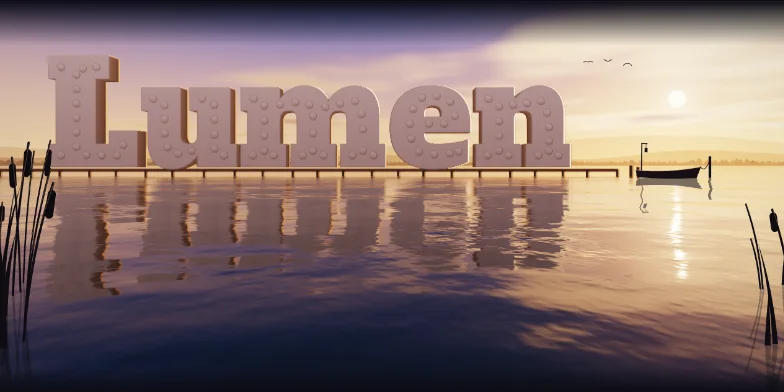

# 一千零一页

《一千零一夜》是一夜讲一个故事；这里是一页做一件东西：一个主题、一个构思，页里只放适合它的东西。每一页都是完整的，从哪一页看起都行。

**在线看：<https://yophon.github.io/1001-pages/>**



## 目录

| 页 | 名字 | 是什么 |
| --- | --- | --- |
| 001 | [倒影](https://yophon.github.io/1001-pages/lake.html) | 黄昏的湖，栈道上的大字和实时算的倒影，天黑以后灯泡一盏盏亮起来 |
| 002 | [镭射闪卡](https://yophon.github.io/1001-pages/holo.html) | 一张镭射收藏卡，颜色按衍射光栅实时算，倾斜时彩虹顺着刻槽流动 |
| 003 | [地铁图](https://yophon.github.io/1001-pages/metro.html) | 品牌名自动画成一张地铁线路图，有列车、站卡和换乘路线规划 |
| 004 | [暗房](https://yophon.github.io/1001-pages/darkroom.html) | 红灯下，品牌名作为一张黑白照片在显影液里慢慢浮出来，最后拉灯绳开灯 |
| 005 | [星球](https://yophon.github.io/1001-pages/planet.html) | 从轨道上看一颗行星，品牌名是大陆，开场是一次轨道日出 |
| 006 | [枯山水](https://yophon.github.io/1001-pages/zen.html) | 一方枯山水，品牌名是白砂里的苔岛，鼠标是一把五齿耙 |
| 007 | [浇铸](https://yophon.github.io/1001-pages/foundry.html) | 铁水灌满字形砂型，按黑体辐射冷却下来，开箱落砂后打磨出光 |
| 008 | [音乐盒](https://yophon.github.io/1001-pages/musicbox.html) | 品牌名打成纸带上的孔，摇动摇柄就奏出一段曲子 |

[速写本](https://yophon.github.io/1001-pages/sketchbook/overview.html)里是一开始的十一批练习：官网底部那行占满整宽的品牌大字，一共 86 种做法。上面有几页就是从这里挑出来重做的。

## 换个名字

每一页的品牌名默认是 Lumen，在网址后面加上 `?name=` 就能换，中文也行，比如：

[planet.html?name=星河](https://yophon.github.io/1001-pages/planet.html?name=%E6%98%9F%E6%B2%B3)

## 在本地打开

不用安装，也不用构建，克隆下来直接用浏览器打开 `index.html` 就行：

```sh
git clone https://github.com/yophon/1001-pages.git
```

- 字体从 Google Fonts 加载，断网时会退回系统字体。
- 有几页用 WebGL2 实时渲染，请用新版的 Chrome、Edge、Safari 或 Firefox。
- 有声音的页面默认静音，点页面里的声音按钮才会出声。

## 目录结构

```
index.html        目录
*.html            正式页面，一页一个文件，不依赖别的文件
covers/           目录用的封面
sketchbook/       速写本：86 种巨字页脚和它们的总览
```
